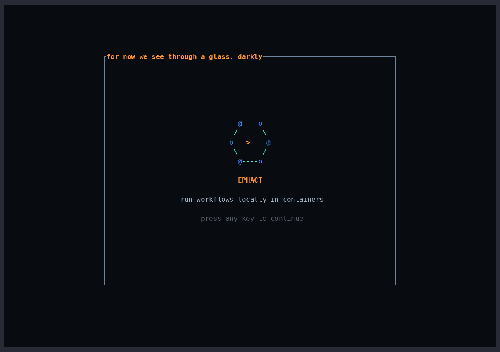
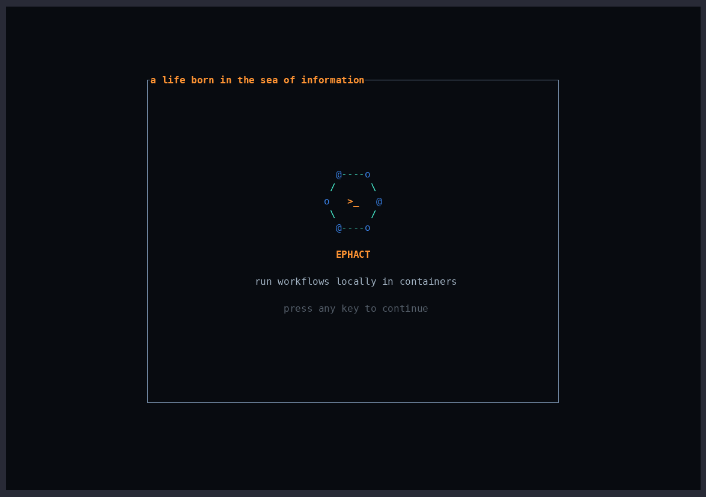

# Ephact TUI Demos

These demonstrations show ephact's terminal user interface running real local
workflow scenarios from `ephact-demos`.

## GitHub Workflow Execution

This demo runs the `GitHub Local Action Success` workflow from
`ephact-demos/github-local-action` through the ephact TUI.

## Woodpecker Workflow Execution

This demo runs the `Woodpecker Shell Variable Expansion` workflow from
`ephact-demos/woodpecker-shell-expansion` through the ephact TUI.

The demos are captured as GIFs in the [docs/gifs](gifs/) directory.
